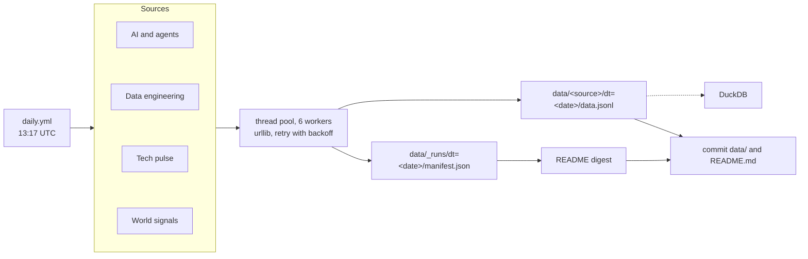

# open-data-pulse

[](https://github.com/Pranavmodem/open-data-pulse/actions/workflows/ci.yml)
[](https://github.com/Pranavmodem/open-data-pulse/actions/workflows/daily.yml)
[](LICENSE)
[](https://docs.python.org/3.12/)

A small data pipeline that takes a daily snapshot of 21 public feeds: AI research and model hubs, agent frameworks, data-engineering tool releases and adoption, platform status, security advisories, and weather, air and hazards in the cities that host the big cloud regions.

A GitHub Actions job runs it every morning. It fetches the feeds in parallel, retries what fails, writes one date-partitioned JSONL file per feed, records a run manifest, and rebuilds this README.

**Last run:** 2026-11-11 20:14 UTC

## Today's digest

### AI and agents

- **arXiv agent papers**: 30 new papers. Newest: [Contrastive Discovery: Open-Ended Scientific Discovery over Competing Explanations](<https://arxiv.org/abs/2611.14514v1>)
- **Hugging Face daily papers**: Top: [Tree-Ising: Repairing Language Models with Bit-Level Ising Edits](<https://huggingface.co/papers/2611.14210>) (71 upvotes)
- **Hugging Face trending models**: #1: [xtools-at/DeepSeek-V4-Pro-Qwen3.5-9B-UNCENSORED-heretic](<https://huggingface.co/xtools-at/DeepSeek-V4-Pro-Qwen3.5-9B-UNCENSORED-heretic>) (text-generation, 2.3K likes)
- **Hugging Face trending datasets**: #1: [Angais/pixel-art-atlas-1.4m](<https://huggingface.co/datasets/Angais/pixel-art-atlas-1.4m>) (41.6K downloads)
- **LLM catalog and prices**: 466 models, 3 new since the last run: Baidu: ERNIE-5.5-Flash-Preview (free), KT: Mi:dm K 3.0 Pro, Motif Technologies: Motif 3
- **New agent and MCP repos**: Top new repo: [voyager-so/vork](<https://github.com/voyager-so/vork>) (1.4K stars in under a week)
- **Agent framework releases**: Latest: [LangChain langchain-core==1.8.0](<https://github.com/langchain-ai/langchain/releases/tag/langchain-core%3D%3D1.8.0>) (today)
- **AI SDK downloads (npm)**: Most downloaded: `@modelcontextprotocol/sdk` 15.1M, `@anthropic-ai/sdk` 11.7M, `openai` 10.1M

### Data engineering

- **Data tool releases**: Latest: [Apache Airflow 3.4.0](<https://github.com/apache/airflow/releases/tag/3.4.0>) (5d ago)
- **Python package downloads**: Yesterday: `pandas` 26.0M, `pyarrow` 15.4M, `openai` 14.5M, `mcp` 12.8M
- **Docker image pulls**: Most pulled since the last run: `library/postgres` (+25.2M)
- **Data engineering articles**: Top: [I built a free Data Engineering pipeline with dbt, DuckDB and GitHub Actions (no AWS)](<https://dev.to/dayan_elvisjahuirapilco/construi-un-pipeline-de-data-engineering-gratis-con-dbt-duckdb-y-github-actions-sin-aws-a3d>) (5 reactions)

### Tech pulse

- **Hacker News front page**: Top: [Google SWE points 48 AI agents at NASA Lidar, finds unmapped Maya pyramid in 72h](<https://news.ycombinator.com/item?id=50452455>) (846 points)
- **Platform status**: Degraded: [Snowflake: Partially Degraded Service](<https://status.snowflake.com>); [Cloudflare: Partially Degraded Service](<https://www.cloudflarestatus.com>)
- **Known exploited vulnerabilities**: 12 added in the week to 2026-11-10. Newest: [CVE-2026-20320](<https://nvd.nist.gov/vuln/detail/CVE-2026-20320>) (Cisco BroadWorks)
- **Most-read Wikipedia articles**: Most read: [Ramayana: Part 1](<https://en.wikipedia.org/wiki/Ramayana%3A_Part_1>) (840.9K), [Russell Brand](<https://en.wikipedia.org/wiki/Russell_Brand>) (545.7K), [Jensen Huang](<https://en.wikipedia.org/wiki/Jensen_Huang>) (542.6K)

### World signals

- **Weather in cloud-region cities**: Dallas 26°C / 16°C, partly cloudy. Hottest: Mumbai (ap-south-1) 35°C. Coldest: Columbus, OH (us-east-2) 4°C
- **Air quality in cloud-region cities**: Worst air: Mumbai (AQI 148). Cleanest: Boardman, OR (AQI 24)
- **Earthquakes**: 33 quakes of M2.5+ in 24h. Largest: [M5.1 80 km W of Panguna, Papua New Guinea](<https://earthquake.usgs.gov/earthquakes/eventpage/us7000txm8>)
- **Natural hazards**: 9 open events: 5 sea and lake ice, 3 severe storms, 1 wildfires
- **Exchange rates**: 1 USD = 0.8987 EUR, 0.7515 GBP, 93.69 INR, 159.2 JPY, 18.66 MXN (ECB, 2026-11-11)

## Sources

| Source | What it tracks | Rows | Status |
| --- | --- | ---: | --- |
| [`arxiv_agent_papers`](data/arxiv_agent_papers) | Newest arXiv papers on LLM agents, agentic systems and multi-agent work. [↗](<https://arxiv.org/>) | 30 | ✅ ok |
| [`hf_daily_papers`](data/hf_daily_papers) | Papers the Hugging Face community picked today, with upvotes and linked code. [↗](<https://huggingface.co/papers>) | 50 | ✅ ok |
| [`hf_trending_models`](data/hf_trending_models) | The 30 models trending on the Hugging Face Hub. [↗](<https://huggingface.co/models?sort=trending>) | 30 | ✅ ok |
| [`hf_trending_datasets`](data/hf_trending_datasets) | The 30 datasets trending on the Hugging Face Hub. [↗](<https://huggingface.co/datasets?sort=trending>) | 30 | ✅ ok |
| [`llm_catalog`](data/llm_catalog) | Every model on OpenRouter with context window and price per million tokens; flags new models. [↗](<https://openrouter.ai/models>) | 466 | ✅ ok |
| [`github_agent_repos`](data/github_agent_repos) | Repos created this week under agent and MCP topics on GitHub, ranked by stars. [↗](<https://github.com/topics/ai-agents>) | 30 | ✅ ok |
| [`ai_framework_releases`](data/ai_framework_releases) | Latest release of the main agent, LLM-serving and model frameworks. [↗](<https://github.com/>) | 13 | ✅ ok |
| [`ai_sdk_downloads`](data/ai_sdk_downloads) | Yesterday's npm downloads for the main LLM and agent SDKs. [↗](<https://www.npmjs.com/>) | 11 | ✅ ok |
| [`data_tool_releases`](data/data_tool_releases) | Latest stable release of the core lakehouse, streaming, orchestration and query engines. [↗](<https://github.com/>) | 13 | ✅ ok |
| [`pypi_downloads`](data/pypi_downloads) | Daily, weekly and monthly PyPI downloads for data and AI libraries. [↗](<https://pypistats.org/>) | 16 | ✅ ok |
| [`docker_pulls`](data/docker_pulls) | Total Docker Hub pulls for data-platform images, with the change since the last run. [↗](<https://hub.docker.com/>) | 11 | ✅ ok |
| [`devto_data_engineering`](data/devto_data_engineering) | Today's top dev.to articles tagged dataengineering. [↗](<https://dev.to/t/dataengineering>) | 20 | ✅ ok |
| [`hackernews_front_page`](data/hackernews_front_page) | The 30 stories on the Hacker News front page at snapshot time. [↗](<https://news.ycombinator.com/>) | 30 | ✅ ok |
| [`cloud_status`](data/cloud_status) | Live status and open incidents for the data and AI platforms teams depend on. [↗](<https://www.atlassian.com/software/statuspage>) | 8 | ✅ ok |
| [`cisa_kev`](data/cisa_kev) | The 20 newest entries in CISA's catalog of vulnerabilities exploited in the wild. [↗](<https://www.cisa.gov/known-exploited-vulnerabilities-catalog>) | 20 | ✅ ok |
| [`wikipedia_top_pages`](data/wikipedia_top_pages) | Yesterday's 25 most-viewed English Wikipedia articles, from the Wikimedia pageviews API. [↗](<https://wikimedia.org/api/rest_v1/>) | 25 | ✅ ok |
| [`cloud_region_weather`](data/cloud_region_weather) | Today's forecast for Dallas and the cities behind nine major AWS regions. [↗](<https://open-meteo.com/>) | 10 | ✅ ok |
| [`air_quality`](data/air_quality) | Current US AQI, PM2.5, PM10 and ozone for the same cities. [↗](<https://open-meteo.com/en/docs/air-quality-api>) | 10 | ✅ ok |
| [`earthquakes`](data/earthquakes) | Every magnitude 2.5+ earthquake in the past 24 hours, from the USGS feed. [↗](<https://earthquake.usgs.gov/earthquakes/feed/>) | 33 | ✅ ok |
| [`natural_events`](data/natural_events) | Open wildfires, storms, volcanoes and other events NASA EONET tracked this week. [↗](<https://eonet.gsfc.nasa.gov/>) | 9 | ✅ ok |
| [`fx_rates`](data/fx_rates) | European Central Bank reference rates against the US dollar. [↗](<https://frankfurter.dev/>) | 29 | ✅ ok |

## Pipeline health

Last 7 runs, newest first.

| Date | Sources ok | Rows | Failed |
| --- | ---: | ---: | --- |
| 2026-11-11 | 21/21 | 894 | none |
| 2026-11-10 | 21/21 | 907 | none |
| 2026-11-09 | 21/21 | 906 | none |
| 2026-11-08 | 21/21 | 887 | none |
| 2026-11-07 | 21/21 | 884 | none |
| 2026-11-06 | 21/21 | 871 | none |
| 2026-11-05 | 21/21 | 882 | none |

## How it works



- **One class per feed.** Each source in [`pipeline/sources/`](pipeline/sources) sets its metadata and implements `fetch()`, which returns rows, and `highlight()`, which writes its line in the digest.
- **Failures stay contained.** Sources run in a thread pool, and HTTP calls retry with backoff. A source that still errors is marked `failed` in the manifest while the rest carry on. The job only fails when fewer than half the sources succeed.
- **Idempotent partitions.** Output goes to `data/<source>/dt=<YYYY-MM-DD>/data.jsonl`. Re-running a day overwrites that day's file, so reruns never duplicate rows.
- **Change detection.** A source can read its previous partition. The LLM catalog flags models that weren't there on the last run, and Docker pulls report the change since the last run.
- **Run manifests.** `data/_runs/dt=<YYYY-MM-DD>/manifest.json` records the status, row count, duration and any error for every source.
- **No dependencies.** Python standard library only.

## Query the data

The layout is Hive-style, so [DuckDB](https://duckdb.org/) reads it in place:

```sql
-- Largest earthquakes across every snapshot
SELECT dt, magnitude, place
FROM read_json_auto('data/earthquakes/*/data.jsonl', hive_partitioning = true)
ORDER BY magnitude DESC
LIMIT 10;

-- Models added to the LLM catalog, by day
SELECT dt, count(*) AS new_models, list(name) AS names
FROM read_json_auto('data/llm_catalog/*/data.jsonl', hive_partitioning = true)
WHERE is_new
GROUP BY dt
ORDER BY dt DESC;

-- Daily PyPI downloads for the data stack
SELECT dt, package, last_day
FROM read_json_auto('data/pypi_downloads/*/data.jsonl', hive_partitioning = true)
WHERE package IN ('pyspark', 'polars', 'duckdb')
ORDER BY dt, package;
```

## Run it locally

```bash
pip install -e .                            # optional; adds the open-data-pulse command
open-data-pulse                             # same entry point as python -m pipeline.run
python -m pipeline.run                      # every source, today's date
python -m pipeline.run --only earthquakes   # one source
python -m unittest discover tests
```

It needs Python 3.11 or newer. Set `GITHUB_TOKEN` for higher GitHub API limits. Spark, Kafka and Flink publish tags instead of GitHub releases, and looking those up needs the token.

## Add a source

Subclass `Source` in the matching module under [`pipeline/sources/`](pipeline/sources), implement `fetch()` and `highlight()`, and add an instance to that module's `SOURCES` list.

## Data and licenses

The code is MIT licensed. Each dataset belongs to its publisher and keeps its own terms: arXiv, Hugging Face, OpenRouter, GitHub, npm, PyPI Stats, Docker Hub, DEV, Hacker News (via Algolia), each platform's status page, CISA, Wikimedia, Open-Meteo, USGS, NASA EONET, and the European Central Bank (via Frankfurter). The Sources table links to each one.
