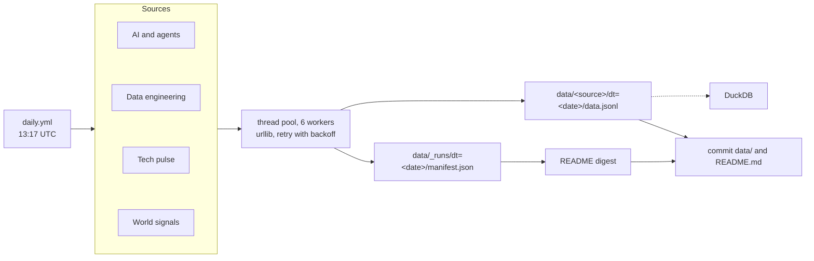

# open-data-pulse

[](https://github.com/Pranavmodem/open-data-pulse/actions/workflows/ci.yml)
[](https://github.com/Pranavmodem/open-data-pulse/actions/workflows/daily.yml)
[](LICENSE)
[](https://docs.python.org/3.12/)

A small data pipeline that takes a daily snapshot of {{source_count}} public feeds: AI research and model hubs, agent frameworks, data-engineering tool releases and adoption, platform status, security advisories, and weather, air and hazards in the cities that host the big cloud regions.

A GitHub Actions job runs it every morning. It fetches the feeds in parallel, retries what fails, writes one date-partitioned JSONL file per feed, records a run manifest, and rebuilds this README.

**Last run:** {{updated}}

## Today's digest

{{digest}}

## Sources

`✅ ok` means every item was fetched, `⚠️ partial` that some items failed (so the row count is short and the digest says why), `⚪ no rows` that the feed had nothing today, and `❌ failed` that nothing came back at all.

{{status}}

## Pipeline health

{{health}}

## How it works



- **One class per feed.** Each source in [`pipeline/sources/`](pipeline/sources) sets its metadata and implements `fetch()`, which returns rows, and `highlight()`, which writes its line in the digest.
- **Failures stay contained.** Sources run in a thread pool, and HTTP calls retry with backoff. A source that still errors is marked `failed` in the manifest while the rest carry on. The job only fails when fewer than half the sources succeed.
- **A short list is never silent.** A feed built from many items (repos, packages, status pages) fetches each one separately: one dead item does not sink the source, but it is recorded, the source is marked `partial`, and the README names the item that failed. The digest says "1 of 9 items failed" instead of letting an eight-row snapshot read as complete.
- **Idempotent partitions.** Output goes to `data/<source>/dt=<YYYY-MM-DD>/data.jsonl`. Re-running a day overwrites that day's file, and removes it when the rerun returns no rows, so a snapshot never keeps rows the latest run did not fetch.
- **Change detection.** A source can read its previous partition. The LLM catalog flags models that weren't there on the last run, and Docker pulls report the change since the last run.
- **Run manifests.** `data/_runs/dt=<YYYY-MM-DD>/manifest.json` records the status, row count, duration and any error for every source, plus the individual items that failed inside a `partial` one.
- **One pass over the template.** Feed text is escaped and substituted once, so a title that happens to look like a template placeholder is rendered as text rather than expanded into the page.
- **No dependencies.** Python standard library only.

## Query the data

The layout is Hive-style, so [DuckDB](https://duckdb.org/) reads it in place:

```sql
-- Largest earthquakes across every snapshot
SELECT dt, magnitude, place
FROM read_json_auto('data/earthquakes/*/data.jsonl', hive_partitioning = true)
ORDER BY magnitude DESC
LIMIT 10;

-- Models added to the LLM catalog, by day
SELECT dt, count(*) AS new_models, list(name) AS names
FROM read_json_auto('data/llm_catalog/*/data.jsonl', hive_partitioning = true)
WHERE is_new
GROUP BY dt
ORDER BY dt DESC;

-- Daily PyPI downloads for the data stack
SELECT dt, package, last_day
FROM read_json_auto('data/pypi_downloads/*/data.jsonl', hive_partitioning = true)
WHERE package IN ('pyspark', 'polars', 'duckdb')
ORDER BY dt, package;
```

## Run it locally

```bash
pip install -e .                            # optional; adds the open-data-pulse command
open-data-pulse                             # same entry point as python -m pipeline.run
python -m pipeline.run                      # every source, today's date
python -m pipeline.run --only earthquakes   # one source
python -m unittest discover tests
```

It needs Python 3.11 or newer. Set `GITHUB_TOKEN` for higher GitHub API limits. Spark, Kafka and Flink publish tags instead of GitHub releases, and looking those up needs the token.

## Add a source

Subclass `Source` in the matching module under [`pipeline/sources/`](pipeline/sources), implement `fetch()` and `highlight()`, and add an instance to that module's `SOURCES` list.

## Data and licenses

The code is MIT licensed. Each dataset belongs to its publisher and keeps its own terms: arXiv, Hugging Face, OpenRouter, GitHub, npm, PyPI Stats, Docker Hub, DEV, Hacker News (via Algolia), each platform's status page, CISA, Wikimedia, Open-Meteo, USGS, NASA EONET, and the European Central Bank (via Frankfurter). The Sources table links to each one.
